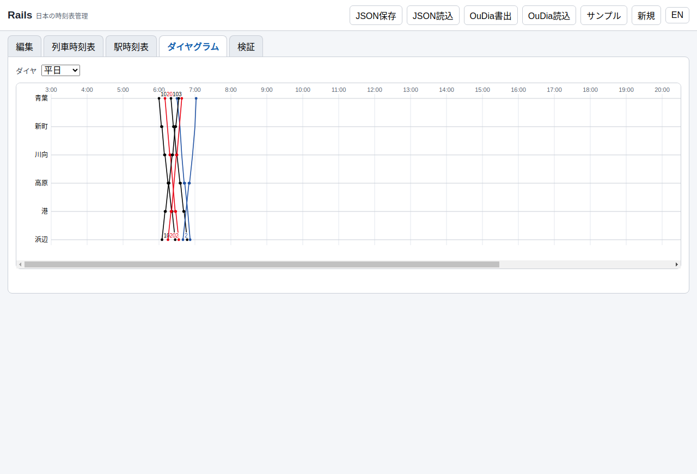
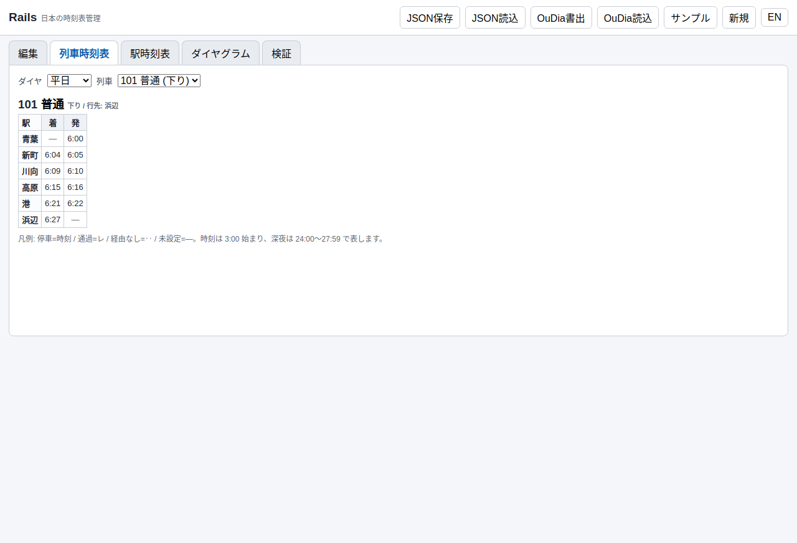

# Rails

日本の時刻表を編集・表示するための時刻表管理ソフトです。ブラウザで開くだけで動き、インストールもサーバーも不要です。小規模鉄道のダイヤ作成、鉄道研究、架空鉄道の制作を想定しています。

## スクリーンショット

ダイヤグラム(サンプル「青葉線」):



列車時刻表:



## 最短の使い方

1. `index.html` をブラウザで開く(同梱のサンプル「青葉線」が表示されます)
2. 「編集」タブで駅・列車種別・列車の時刻を直す(変更は自動でブラウザ内に保存されます)
3. 「列車時刻表」「駅時刻表」「ダイヤグラム」タブで結果を確認し、「検証」タブで時刻の矛盾をチェックする

## できること

- 路線(駅の並び)、列車種別(名前・略称・色)、ダイヤ(平日/土休日など)、列車(番号・種別・方向・各駅の着発時刻)の編集
- 各駅の状態は「停車/通過/経由なし/未設定」を保持
- 列車時刻表、駅時刻表(時帯別・種別色・行先つき)、ダイヤグラム(SVG)の表示
- 検証: 着>発、時刻の逆行、途中駅での着のみ/発のみ、停車なのに時刻なし等を警告リストで表示
- 時刻は1日の始まりを 3:00 とし、深夜は 24:00〜27:59 で表記

## 対応形式

| 形式 | 読み込み | 書き出し |
|---|---|---|
| JSON (本ソフト独自) | ○ | ○ |
| OuDia `.oud` | ○ (Shift_JIS / UTF-8) | ○ (UTF-8) |

OuDia は路線・駅・種別・ダイヤ・列車・時刻の基本構造に対応します。書き出しは UTF-8 のため、OuDia 本体で開く際に文字コード変換が必要な場合があります。

## やらないこと

- 番線(ホーム)管理、乗務員運用、運賃計算
- 実在事業者の公式データの取り込み・配布
- サーバー、会員登録、データベース(データは利用者の端末とファイルにだけ置きます)

## 開発

テストは Node.js で実行できます(依存パッケージなし)。

```
node tests/test.js
```

`index.html` 内のコアロジック(データモデル・時刻計算・検証・OuDia 入出力)を抽出して検証します。
